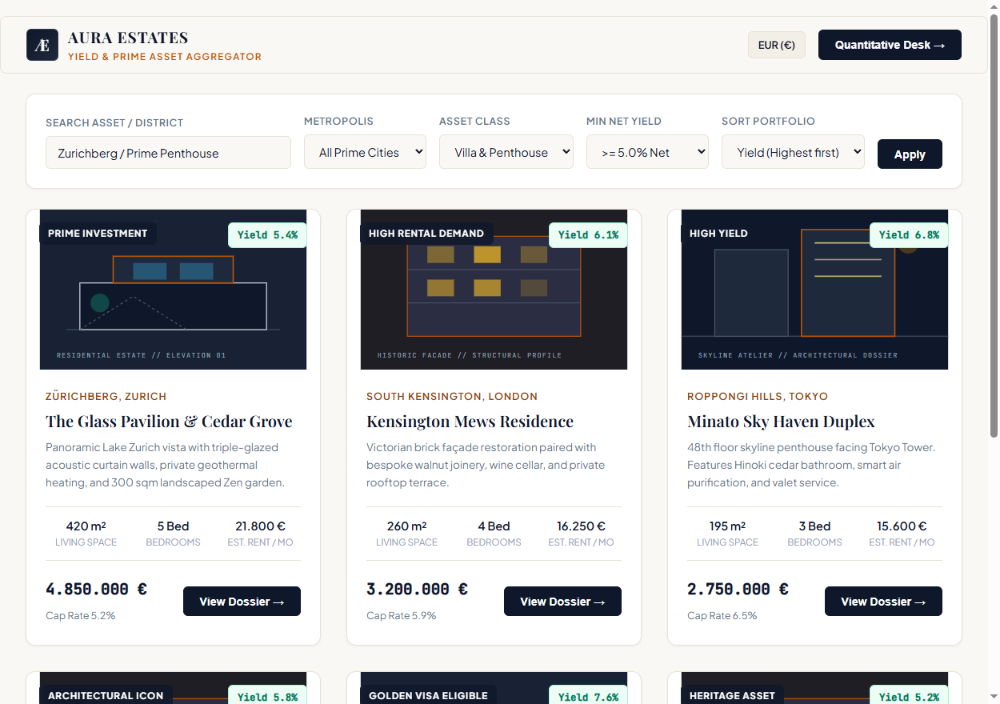
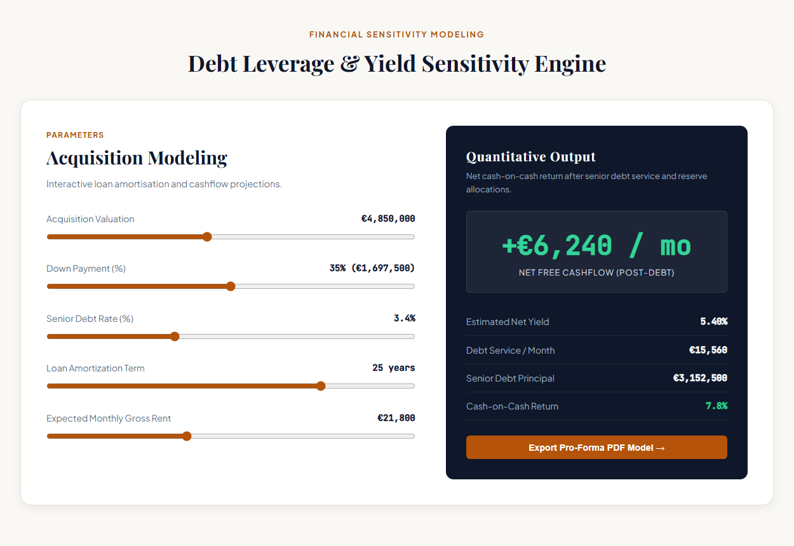

# Aura Estates — Prime Yield & PropTech Aggregator

Платформа-агрегатор премиальной международной недвижимости и инвестиционной аналитики с акцентом на чистую доходность (Net Yield / Cap Rate) и финансовое моделирование долгового плеча.

Спроектирована в эстетике **Warm Editorial & Quiet Luxury**: теплая бежево-овсяная палитра (`#FAF8F5`, `#F3EFE6`), глубокий чернильный сланец (`#0F172A`), акцентная охра/золото (`#B45309`), шрифтовой дуэт классической антиквы *Playfair Display* и гротеска *Plus Jakarta Sans*.

---

## Визуальный обзор платформы

### 1. Каталог объектов и многофакторный фильтр
Интерактивный отбор объектов по мегаполисам (Цюрих, Токио, Лондон, Дубай, Париж, Нью-Йорк), классам активов, минимальному Net Yield и сортировке. Карточки содержат векторные архитектурные профили, метрики площади, расчетную аренду и статус правового аудита.



### 2. Финансовый симулятор чувствительности и окупаемости
Динамический расчет ежемесячного обслуживания долга, чистого операционного дохода (NOI), чистого денежного потока после выплат по ипотеке (Cashflow) и возврата на вложенный капитал (Cash-on-Cash Return).



### 3. Инвестиционный досье-профайл объекта (Dossier Modal)
Детальная карточка с правовой верификацией (проверка земельного кадастра, класс энергоэффективности A+, эскроу-сопровождение арендных договоров) и формой защищенного запроса 48-страничного аудиторского отчета.


---

## Архитектура и функционал

- **Клиентская часть:** Чистый модульный Vanilla ES6+ и современный CSS3 (CSS Variables, Flexbox, CSS Grid, SVG-графика без внешних растровых зависимостей).
- **Серверная часть:** `server.py` на стандартной библиотеке Python 3 (работает из коробки на любой машине без `pip install`), с поддержкой расширения через FastAPI.
- **Интерактивные модули:**
  - `PROPERTIES_DATA`: структурированная база данных активов с финансовыми метриками.
  - Калькулятор ипотечного аннуитета: формула $M = P \frac{r(1+r)^n}{(1+r)^n - 1}$ с учетом затрат на управляющую компанию и амортизацию.
  - Живая фильтрация и мгновенный поиск без перезагрузки страниц.
  - Модальные инвестиционные досье с валидацией запроса.

---

## Быстрый старт

### Вариант 1. Запуск через встроенный Python-сервер
```bash
cd 09-proptech-aggregator
python server.py
```
После запуска откройте в браузере: [http://127.0.0.1:8002](http://127.0.0.1:8002)

### Вариант 2. Просмотр напрямую
Файл `index.html` полностью автономен и открывается двойным кликом в любом современном браузере.

---

## Структура проекта

```
09-proptech-aggregator/
├── assets/
│   ├── preview-catalog.png      # Скриншот каталога и фильтров
│   ├── preview-calculator.png   # Скриншот финансового симулятора
│   └── preview-modal.png        # Скриншот инвестиционного досье
├── data/
│   └── properties.json          # Базовый датасет объектов
├── static/
│   ├── css/
│   │   └── style.css            # Editorial Luxury стили
│   └── js/
│       └── main.js              # Фильтрация, калькулятор и модальные окна
├── index.html                   # Главная страница платформы
├── server.py                    # Локальный веб-сервер
├── requirements.txt             # Спецификация окружения
└── README.md
```
